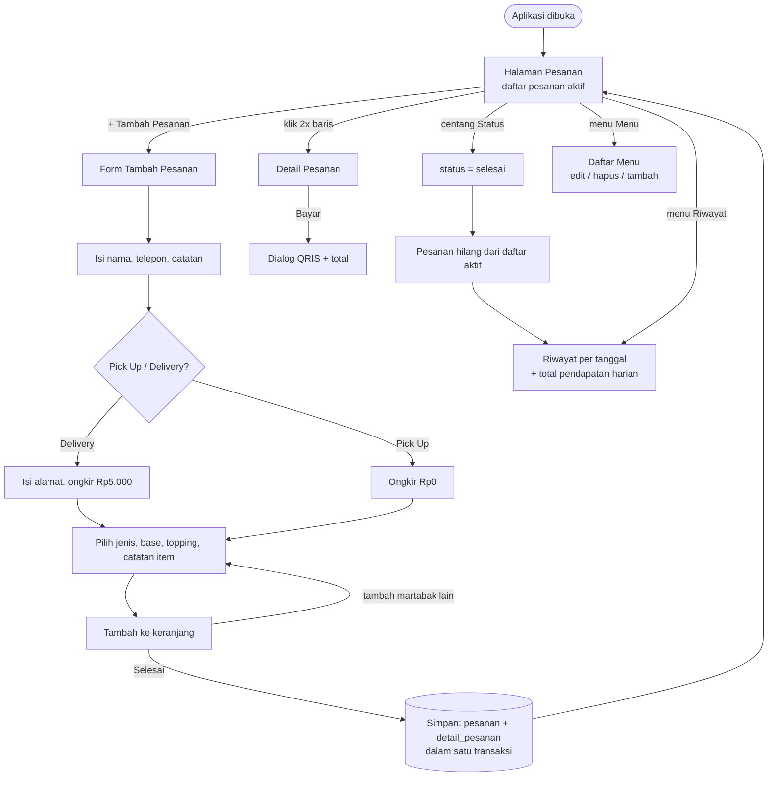

# Martabak — Aplikasi Pemesanan Martabak Custom

Aplikasi desktop (Java Swing + MySQL) untuk mencatat dan mengelola pesanan martabak custom. Dipakai satu operator (kasir/penjual) di satu perangkat.

---

## Daftar Isi

1. [Masalah yang Disorot](#masalah-yang-disorot)
2. [Tujuan Pengembangan](#tujuan-pengembangan)
3. [Fitur yang Sudah Dibuat](#fitur-yang-sudah-dibuat)
4. [Alur Aplikasi](#alur-aplikasi)
5. [Struktur Proyek](#struktur-proyek)
6. [Database](#database)
7. [Keterbatasan dan Bug yang Diketahui](#keterbatasan-dan-bug-yang-diketahui)
8. [Rencana vs Implementasi](#rencana-vs-implementasi)
9. [Cara Menjalankan](#cara-menjalankan)
10. [Rencana Perbaikan](#rencana-perbaikan)

---

## Masalah yang Disorot

**Kasus:** usaha martabak custom skala kecil, dikelola satu orang. Pesanan datang dari banyak arah (chat, telepon, datang langsung) dan hampir tiap pesanan berbeda: jenis, base, topping, catatan, serta diambil sendiri atau diantar. Pencatatan yang dilakukan secara manual membuat masalah berikut muncul.

| # | Masalah di lapangan | Dampak |
|---|---|---|
| 1 | **Pesanan tercecer.** Tersebar di chat, kertas, atau hanya diingat. | Pesanan terlewat atau lupa diantar; sulit memastikan mana yang sudah dikerjakan. |
| 2 | **Riwayat tercecer.** Pesanan yang sudah selesai tidak tersimpan terpusat. | Sulit dicari ulang ("kemarin si A pesan apa?"), tidak ada jejak transaksi. |
| 3 | **Rekap pendapatan harian manual.** Total dijumlah dari catatan yang berserakan. | Rawan salah hitung dan memakan waktu saat tutup hari. |
| 4 | **Pesanan custom ribet dicatat.** Satu pesanan bisa berisi beberapa loyang dengan base dan topping berbeda, plus catatan. | Salah tangkap detail; salah buat martabak. |
| 5 | **Harga dihitung manual.** Base + topping + ongkir, berbeda tiap loyang. | Salah total dan harga tidak konsisten antarpesanan. |
| 6 | **Tidak jelas mana yang belum selesai.** Tidak ada daftar antrean yang terpisah dari pesanan yang sudah beres. | Sulit memprioritaskan dan memantau pesanan aktif. |
| 7 | **Daftar menu dan harga tidak terpusat.** Harga hanya diingat atau tertulis di beberapa tempat. | Harga tidak seragam saat menu atau harga berubah. |
| 8 | **Pembayaran terpisah dari pesanan.** QRIS dan nominal disiapkan sendiri. | Nominal bisa keliru saat pelanggan membayar. |

**Bagaimana aplikasi ini menjawabnya**

| Masalah | Jawaban di aplikasi |
|---|---|
| 1 Pesanan tercecer | Semua pesanan diinput lewat satu form dan masuk ke database; daftar **Pesanan** menampilkan semua yang aktif. |
| 2 Riwayat tercecer | Pesanan selesai pindah ke halaman **Riwayat** yang bisa dicari per tanggal. |
| 3 Rekap harian manual | **Total Pendapatan Harian** dihitung otomatis di Riwayat. |
| 4 Pesanan custom | Keranjang multi-martabak dengan base, topping, dan catatan per item. |
| 5 Harga manual | Subtotal, ongkir, dan total dihitung otomatis dari harga menu. |
| 6 Antrean tidak jelas | Daftar **Pesanan** hanya berisi yang belum selesai; centang status untuk menyelesaikan. |
| 7 Menu tidak terpusat | Halaman **Menu** untuk mengelola base, topping, dan harga. |
| 8 Pembayaran terpisah | Tombol **Bayar** di detail pesanan menampilkan QRIS dan total. |

---

## Tujuan Pengembangan

Aplikasi ini dibuat untuk:

- **Mencatat pesanan custom dengan rapi:** jenis martabak (manis/telor), base, topping, catatan per loyang, dan data pelanggan.
- **Menghitung harga otomatis:** subtotal per loyang, ongkir (untuk Delivery), dan total.
- **Memantau pesanan yang belum selesai** dalam satu daftar yang simpel.
- **Merekap pendapatan harian** dari pesanan yang sudah selesai.
- **Mengelola menu dan harga** tanpa harus mengubah kode atau database langsung.
- Menjadi **proyek belajar** untuk Java Swing (NetBeans GUI Builder), JDBC, dan perancangan basis data relasional.

**Di luar cakupan (sengaja belum dibuat):** login/multi-user, manajemen pelanggan terpisah, laporan bulanan, cetak struk, integrasi pembayaran otomatis.

---

## Fitur yang Sudah Dibuat

### 1. Pesanan (halaman utama)
- Menampilkan pesanan **aktif** (status belum selesai): Nomor, Waktu, Nama, Pengambilan, Total, Status.
- **Centang kolom Status** untuk menandai pesanan selesai. Nilai langsung disimpan ke database dan baris hilang dari daftar (pindah ke Riwayat).
- **Klik dua kali** pada baris untuk membuka **Detail Pesanan**.
- Tombol **+ Tambah Pesanan**. Daftar dimuat ulang otomatis setelah form ditutup.

### 2. Tambah Pesanan
- Data pelanggan: **nama** (wajib), **no. telepon** (opsional), **catatan** pesanan (opsional).
- Metode pengambilan: **Pick Up** atau **Delivery**. Alamat hanya muncul dan wajib diisi jika Delivery.
- Konfigurasi per martabak:
  - Pilih jenis **Manis** atau **Telor** → daftar base dan topping dimuat dari database sesuai jenis.
  - Pilih **satu base** (combo box) dan **nol atau lebih topping** (checkbox).
  - **Catatan per item** (opsional).
- **Keranjang**: setiap martabak yang ditambahkan muncul sebagai baris (No, Jenis, Base, Topping, Harga). **Klik dua kali baris untuk menghapusnya.**
- Perhitungan otomatis: `Subtotal = Σ (harga base + harga topping)`, `Ongkir = Rp5.000 jika Delivery, Rp0 jika Pick Up`, `Total = Subtotal + Ongkir`.
- Penyimpanan memakai **transaksi database** (commit/rollback), jadi pesanan tidak tersimpan setengah-setengah kalau ada error.

### 3. Detail Pesanan
- Menampilkan waktu, nama, telepon, pengambilan, alamat, daftar item (jenis, base, topping, harga), subtotal, ongkir, dan total.
- Tombol **Bayar** membuka dialog **QRIS** (gambar statis `qris.jpg`) beserta nominal total.

### 4. Menu
- Empat tabel menu dalam satu halaman: **Base Manis, Topping Manis, Base Telor, Topping Telor**.
- **Edit langsung di tabel** (klik sel, ubah nama/harga, tersimpan otomatis). Validasi: nama tidak boleh kosong, harga harus angka > 0.
- **Hapus** lewat klik kanan → Hapus, atau tombol `Delete`, dengan dialog konfirmasi. Item yang sudah dipakai di pesanan ditolak oleh database dan muncul pesan "tidak bisa dihapus karena sudah dipakai di pesanan".
- Dialog **Tambah Menu** (nama + harga) dengan validasi input. *(Lihat catatan: baru satu dari empat tombol yang tersambung.)*

### 5. Riwayat
- Menampilkan pesanan **selesai** pada tanggal tertentu (default hari ini; format `dd/MM/yyyy`, tekan Enter untuk memuat).
- Kolom: No, Waktu, Nama Pelanggan, Ringkasan Pesanan (mis. `2 Manis, 1 Telor`), Harga.
- **Total Pendapatan Harian** dihitung otomatis.

### 6. Navigasi
- Menu bar di setiap halaman: **Pesanan | Menu | Riwayat**. Berpindah halaman membuka frame baru dan menutup frame lama.

---

## Alur Aplikasi



**Alur utama sehari-hari:** pelanggan memesan → operator input di *Tambah Pesanan* → pesanan muncul di *Pesanan* → saat martabak jadi/dibayar, operator centang *Status* → pesanan masuk *Riwayat* dan dihitung ke pendapatan hari itu.

---

## Struktur Proyek

```
martabak-main/
├── pom.xml                         # Maven; Java release 25; mysql-connector-j 8.4.0
├── lib/unknown/binary/AbsoluteLayout/SNAPSHOT/
│   └── AbsoluteLayout-SNAPSHOT.jar # dependensi lokal bawaan NetBeans
└── src/main/
    ├── resources/image/qris.jpg    # gambar QRIS untuk dialog Bayar
    └── java/com/mycompany/martabak/
        ├── Martabak.java           # entry point → membuka frame `pesanan`
        ├── Koneksi.java            # koneksi JDBC (localhost:3306/martabak)
        ├── pesanan.java/.form      # JFrame: daftar pesanan aktif (halaman utama)
        ├── tambahPesanan.java/.form# JFrame: form pesanan baru + logika keranjang & simpan
        ├── detailPesanan.java/.form# JDialog: detail pesanan + tombol Bayar
        ├── bayar.java/.form        # JDialog: tampilan QRIS + total
        ├── menu.java/.form         # JFrame: kelola menu (4 tabel)
        ├── tambahMenu.java/.form   # JDialog: tambah menu baru
        └── riwayat.java/.form      # JFrame: riwayat harian + pendapatan
```

| Lapisan | Kondisi saat ini |
|---|---|
| **GUI** | 7 kelas Swing, dibuat dengan NetBeans GUI Builder (file `.form` + kode `initComponents` otomatis). |
| **Logika bisnis** | Menyatu di kelas GUI (mis. `tambahPesanan` punya kelas dalam `Opsi` dan `ItemPesan`, hitung total, dan simpan). Belum ada kelas model terpisah. |
| **Akses data** | Query JDBC langsung di kelas GUI memakai `PreparedStatement`. Belum ada lapisan DAO. `Koneksi` hanya menyediakan koneksi. |

---

## Database

Database: `martabak` (MySQL/MariaDB, `localhost:3306`).

```sql
CREATE DATABASE martabak;
USE martabak;

CREATE TABLE menu_base (
    id_base INT AUTO_INCREMENT PRIMARY KEY,
    kategori VARCHAR(10) NOT NULL,          -- 'manis' | 'telor'
    nama VARCHAR(100) NOT NULL,
    harga INT NOT NULL
);

CREATE TABLE menu_topping (
    id_topping INT AUTO_INCREMENT PRIMARY KEY,
    kategori VARCHAR(10) NOT NULL,          -- 'manis' | 'telor'
    nama VARCHAR(100) NOT NULL,
    harga INT NOT NULL
);

CREATE TABLE pesanan (
    id_pesanan INT AUTO_INCREMENT PRIMARY KEY,
    waktu DATETIME DEFAULT CURRENT_TIMESTAMP,   -- tidak diisi oleh kode, jadi harus punya default
    nama_pelanggan VARCHAR(100) NOT NULL,
    no_telepon VARCHAR(20) NULL,
    pengambilan VARCHAR(10) NOT NULL,           -- 'Pick Up' | 'Delivery'
    alamat TEXT NULL,
    catatan TEXT NULL,
    ongkir INT NOT NULL DEFAULT 0,
    total INT NOT NULL,
    status TINYINT NOT NULL DEFAULT 0           -- 0 = belum selesai, 1 = selesai
);

CREATE TABLE detail_pesanan (
    id_detail INT AUTO_INCREMENT PRIMARY KEY,   -- kemungkinan ada; tidak dipakai kode
    id_pesanan INT NOT NULL,
    no_item INT NOT NULL,                       -- nomor urut martabak dalam pesanan
    id_base INT NOT NULL,
    id_topping INT NULL,                        -- NULL = baris base
    jumlah INT NOT NULL DEFAULT 1,
    harga_satuan INT NOT NULL,
    subtotal INT NOT NULL,
    catatan TEXT NULL,
    FOREIGN KEY (id_pesanan) REFERENCES pesanan(id_pesanan),
    FOREIGN KEY (id_base) REFERENCES menu_base(id_base),
    FOREIGN KEY (id_topping) REFERENCES menu_topping(id_topping)
);
```

**Cara satu martabak disimpan di `detail_pesanan`:** satu baris untuk base (`id_topping = NULL`, harga base) ditambah satu baris per topping (`id_base` sama, `id_topping` terisi, harga topping). Semua baris satu martabak berbagi `no_item` yang sama. Jumlah martabak = `COUNT(DISTINCT no_item)`, dan harga item = `SUM(subtotal)` per `no_item`.

---

## Rencana vs Implementasi

Perbandingan dengan `rancangan_aplikasi_martabak_revisi.md`:

| Aspek | Rancangan | Kondisi sekarang |
|---|---|---|
| Navigasi | 3 halaman: Daftar Pesanan, Tambah Pesanan, Daftar Menu | 3 halaman + **Riwayat** (baru); Tambah Pesanan berupa jendela terpisah |
| Tabel database | 6 (`pelanggan`, `kategori_menu`, `menu`, `pesanan`, `detail_pesanan`, `detail_komponen`) | **4** (`menu_base`, `menu_topping`, `pesanan`, `detail_pesanan`) |
| Konfigurasi loyang | Kartu per loyang, bisa banyak, masing-masing mandiri | Satu panel konfigurasi + **keranjang**; fungsinya setara, tampilannya berbeda |
| Data pelanggan | Master pelanggan + pencocokan nomor telepon + snapshot | Disimpan langsung di `pesanan`, tanpa master dan tanpa pencocokan |
| Snapshot nama/harga | Nama dan harga komponen di-snapshot | **Harga** ter-snapshot; **nama** tidak |
| Status pesanan | Belum Selesai / Selesai, **terpisah dari arsip** | Selesai = hilang dari daftar aktif, dan jadi isi Riwayat; tidak ada arsip |
| Pencarian dan filter | Cari ID/nama, filter status, filter aktif/arsip | Belum ada |
| Aksi detail | Tandai Selesai, Arsipkan, Tutup | **Bayar** (QRIS); "selesai" lewat checkbox di daftar |
| Menu nonaktif | `is_active`, tidak boleh hapus permanen | Hapus permanen (dibatasi FK); belum ada `is_active` |
| Ongkir | Tarif flat, nilai ditetapkan sebelum implementasi | Ditetapkan Rp5.000 di kode |
| Istilah | "Telur" | "Telor" (kode dan database) |
| Fitur tambahan di luar rancangan | – | Riwayat + pendapatan harian, dialog QRIS, catatan pesanan dan per item |

---
